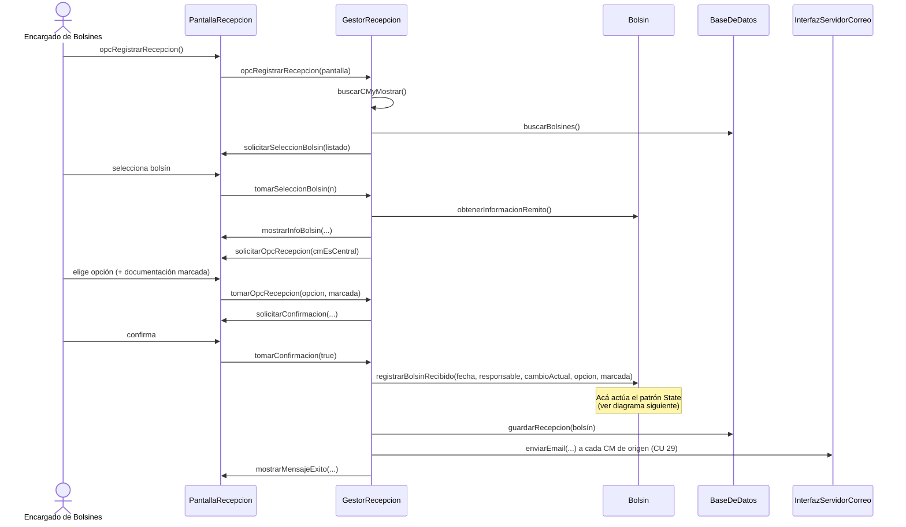
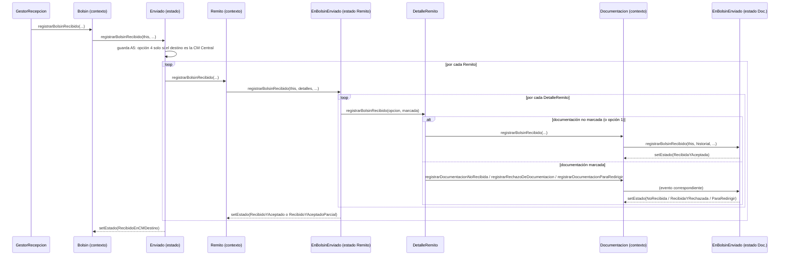
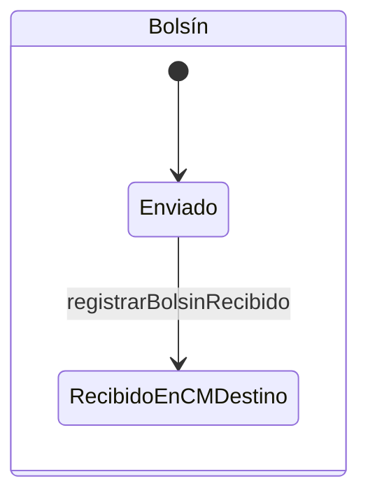
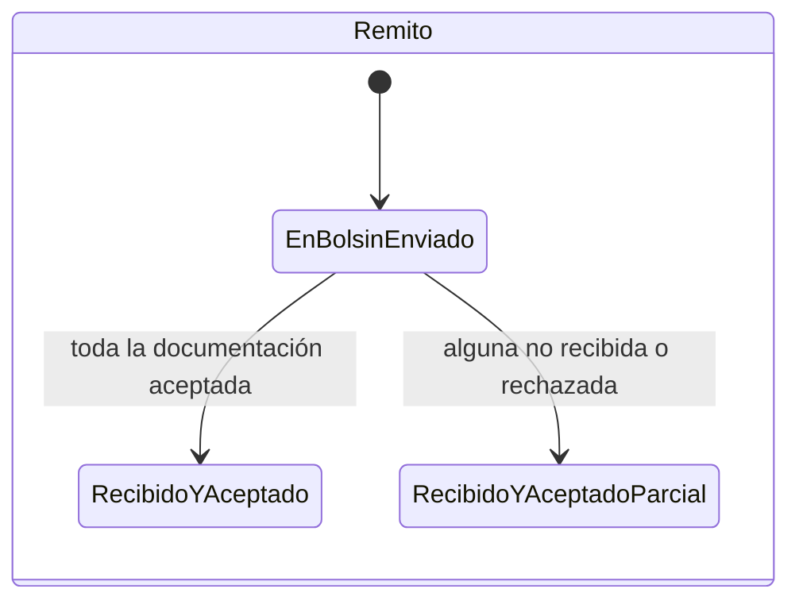
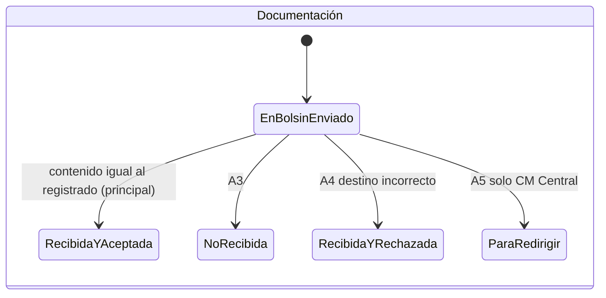

# PPAI Bolsines – CU 28 «Registrar recepción de bolsín»

Trabajo práctico de Diseño de Sistemas de Información (UTN FRC). Implementa el caso de uso **CU 28 – Registrar recepción de bolsín** en Java, aplicando el **patrón State** sobre las entidades que cambian de estado: `Bolsin`, `Remito` y `Documentacion`.

- Java 21, Maven, sin frameworks (servidor web con `com.sun.net.httpserver`, JDBC puro).
- Persistencia en **SQLite** (`data/bolsines.db`), que se crea y se carga con datos de prueba al primer arranque.
- Dos interfaces para el mismo caso de uso: **web** (React servido por el propio programa) y **consola**.

## Índice

1. [Requisitos](#requisitos)
2. [Cómo ejecutarlo](#cómo-ejecutarlo)
3. [Datos de prueba](#datos-de-prueba)
4. [Estructura del proyecto](#estructura-del-proyecto)
5. [Secuencia del caso de uso](#secuencia-del-caso-de-uso)
6. [Cómo se usa el patrón State](#cómo-se-usa-el-patrón-state)
7. [Tests](#tests)

## Requisitos

- **JDK 21** o superior (`java -version`)
- **Maven 3.9+** (`mvn -v`)
- Conexión a internet solo la primera vez (Maven descarga las dependencias). React y Babel ya vienen incluidos en `src/main/resources/static/vendor/`, así que la web funciona sin conexión.

## Cómo ejecutarlo

Desde la carpeta raíz del proyecto:

```bash
# Interfaz web (por defecto) -> http://localhost:8080
mvn -q compile exec:java

# Interfaz web en otro puerto
mvn -q compile exec:java -Dexec.args="9090"

# Interfaz por consola
mvn -q compile exec:java -Dexec.args="consola"
```

Para detener el servidor web, `Ctrl+C`.

También se puede compilar un paquete y ejecutar las clases directamente:

```bash
mvn -q compile
mvn -q dependency:build-classpath -Dmdep.outputFile=cp.txt
java -cp "target/classes:$(cat cp.txt)" bolsines.Main          # en Windows usar ';' en lugar de ':'
```

### Reiniciar los datos

La base se guarda en `data/bolsines.db` (está en `.gitignore`). Para volver al estado inicial de los datos de prueba, detené la aplicación y borrá el archivo:

```bash
rm data/bolsines.db      # Windows PowerShell: Remove-Item data\bolsines.db
```

Se vuelve a crear solo al próximo arranque.

## Datos de prueba

Todos los usuarios tienen contraseña `ppai2026`. El empleado con el que se inicia sesión determina la Comisión Médica (CM) **destino** de los bolsines que se pueden recibir.

| Usuario      | Empleado         | CM del empleado          | Bolsines «Enviado» que puede recibir |
|--------------|------------------|--------------------------|--------------------------------------|
| `cmendez`    | Carolina Méndez  | Tucumán (TUC)            | 2001, 2002, 2003                     |
| `hrojas`     | Hernán Rojas     | **Central (CMC)**        | 2004, 2005                           |
| `sbenitez`   | Sofía Benítez    | Salta (SLA)              | 2006                                 |
| `tcabrera`   | Tomás Cabrera    | Santa Fe (SFE)          | —                                    |
| `vsuarez`    | Valeria Suárez   | Jujuy (JUJ)              | —                                    |

- Solo la **Comisión Médica Central** (`hrojas`) puede usar la opción *«La documentación se debe redirigir a otra área»*.
- El bolsín 2007 está en estado *Cerrado*: sirve de control, no aparece en ningún listado.
- Un usuario sin bolsines pendientes (por ejemplo `tcabrera`) ve el mensaje «No hay bolsines en estado Enviado…».

## Estructura del proyecto

```
src/main/java/bolsines
├── Main.java                    Arranque (web o consola)
├── boundary/                    Pantallas (interfaz) y servidor de correo simulado
│   ├── PantallaRecepcion        Interfaz que ve el gestor
│   ├── PantallaRecepcionWeb     Implementación web
│   ├── PantallaRecepcionConsola Implementación por consola
│   └── InterfazServidorCorreo   Simula el envío de emails (CU 29)
├── control/
│   └── GestorRecepcion          Controlador del CU 28
├── entity/                      Dominio: Bolsin, Remito, DetalleRemito, Documentacion, ...
│   └── estado/
│       ├── bolsin/              Estados de Bolsín (State)
│       ├── remito/              Estados de Remito (State)
│       └── documentacion/       Estados de Documentación (State)
├── persistencia/                SQLite con JDBC puro (BaseDeDatos, Esquema, MapeoEstados)
└── web/                         Servidor HTTP (ServidorWeb) y JSON mínimo
src/main/resources/static/       Página web (app.js con React)
src/test/java/bolsines/          Tests del caso de uso
```

El proyecto sigue la arquitectura **Boundary – Control – Entity** del diseño: la pantalla (boundary) solo habla con el `GestorRecepcion` (control), y este opera sobre las entidades.

## Secuencia del caso de uso

**Actor:** Encargado de Bolsines (EB) de una CM. **Objetivo:** registrar que un bolsín enviado a su CM llegó, indicando qué pasó con la documentación.

### Flujo principal

| Paso | Qué ocurre | Dónde está en el código |
|------|------------|--------------------------|
| 1 | El EB elige *Registrar recepción de bolsín*. | `GestorRecepcion.opcRegistrarRecepcion` |
| 2 | El sistema obtiene la CM del EB logueado (Sesión → Usuario → Empleado → CM) y la muestra. | `buscarCMyMostrar` |
| 3 | Busca y lista los bolsines **en estado Enviado** cuyo destino es esa CM. | `buscarBolsinesEnviados` |
| 4 | El EB puede filtrar por **número de precinto** o por **CM de origen**. | `tomarFiltroPrecinto`, `tomarFiltroCMOrigen` |
| 5 | El EB selecciona un bolsín. | `tomarSeleccionBolsin` |
| 6 | El sistema muestra su información: remitos y documentación. | `buscarInformacionBolsin` |
| 7 | El sistema ofrece las **cuatro opciones de recepción**. | `PantallaRecepcion.solicitarOpcRecepcion` |
| 8 | El EB elige una opción (la 1 es el flujo principal). | `tomarOpcRecepcion` |
| 9 | El sistema pide confirmación. | `PantallaRecepcion.solicitarConfirmacion` |
| 10 | El EB confirma. | `tomarConfirmacion` |
| 11 | El sistema **registra la recepción**: cambia el estado del bolsín, de sus remitos y de su documentación, y lo guarda en la base. | `registrarBolsinRecibido` → patrón State |
| 12 | Incluye el **CU 29**: se envía un email a cada CM de origen con la situación de su documentación. | `llamarCasoDeUsoNotificarRecepcionDeBolsin` |
| 13 | Se muestra el mensaje de éxito y termina el caso de uso. | `mostrarMensajeExito`, `finCasoDeUso` |

### Opciones de recepción (paso 7) y flujos alternativos

| Opción | Significado | Alternativo | Estado en que queda la documentación marcada |
|--------|-------------|-------------|-----------------------------------------------|
| 1 | El contenido es igual al registrado | Flujo principal | Recibida y Aceptada |
| 2 | No se recibe toda la documentación | A3 | No Recibida |
| 3 | Hay documentación que no corresponde al destino | A4 | Recibida y Rechazada |
| 4 | La documentación se debe redirigir a otra área (**solo CM Central**) | A5 | Para Redirigir |

En las opciones 2, 3 y 4 el EB debe marcar a qué documentación se aplica; el resto del bolsín se recibe normalmente.

Otros alternativos:

- **A1 / A2:** el filtro por precinto o por CM de origen no devuelve resultados → se informa y el EB puede seguir.
- **A6:** el EB no confirma → no se registra nada y se vuelve a pedir la opción.
- **Observación 1:** el EB puede cancelar en cualquier momento → no se guarda ningún cambio.

### Diagrama de secuencia (flujo principal)



## Cómo se usa el patrón State

### Idea

Antes del rediseño, el gestor buscaba los estados destino y se los pasaba a las entidades (`buscarEstados()`), con lo cual **conocía la máquina de estados**. Con State, esa responsabilidad se movió a los propios estados:

- El gestor hace **una sola llamada** al contexto: `bolsin.registrarBolsinRecibido(...)`.
- El contexto **delega sin ningún `if`** en su estado actual.
- Cada **estado concreto** sabe si el evento está permitido, qué hacer y **cuál es el estado siguiente** (él mismo lo crea).

### Roles

| Rol del patrón | Bolsín | Remito | Documentación |
|----------------|--------|--------|---------------|
| **Cliente** | `GestorRecepcion` | `Bolsin` (vía estado) | `DetalleRemito` |
| **Contexto** | `Bolsin` | `Remito` | `Documentacion` |
| **Estado (abstracto)** | `EstadoBolsin` | `EstadoRemito` | `EstadoDocumentacion` |
| **Estados concretos** | `Creado`, `Cerrado`, **`Enviado`**, `RecibidoEnCMDestino`, `DeBaja` | `Creado`, `EnBolsinSaliente`, **`EnBolsinEnviado`**, `RecibidoYAceptado`, `RecibidoYAceptadoParcial`, `Cancelado` | `Registrada`, `EnRemito`, `EnBolsinSaliente`, **`EnBolsinEnviado`**, `RecibidaYAceptada`, `RecibidaYRechazada`, `NoRecibida`, `ParaRedirigir`, `DeBaja` |

Los estados en **negrita** son los que tienen transiciones de salida en este caso de uso.

### Cómo funciona en el código

**1. El estado abstracto define el evento con una implementación por defecto: «transición no permitida».**
Los estados concretos solo redefinen los eventos que tienen una flecha de salida en su máquina de estados.

```java
// EstadoBolsin.java
public void registrarBolsinRecibido(Bolsin bolsin, ...) {
    throw new TransicionNoPermitidaException("registrarBolsinRecibido", getNombre());
}
```

**2. El contexto delega en su estado actual, sin condicionales.**

```java
// Bolsin.java
public void registrarBolsinRecibido(...) {
    estadoActual.registrarBolsinRecibido(this, fechaHoraActual, responsable, remitos,
            cambioEstadoActual, opcion, documentacionMarcada);
}
```

**3. El estado concreto ejecuta la transición y crea a su sucesor.**
`Enviado` es el único estado de Bolsín que admite el evento:

```java
// Enviado.java (resumen)
for (Remito remito : remitos) {
    remito.registrarBolsinRecibido(...);             // propaga a los remitos
}
cambioEstadoActual.setFechaHoraFin(fechaHoraActual); // cierra el cambio de estado vigente
EstadoBolsin nuevo = new RecibidoEnCMDestino();      // el estado conoce a su sucesor
bolsin.setEstado(nuevo);                             // el contexto queda en el nuevo estado
bolsin.agregarCambioEstado(new CambioEstadoBolsin(fechaHoraActual, responsable, nuevo));
```

### El evento se propaga en cascada

Una sola llamada del gestor termina cambiando el estado de **tres niveles** de objetos. Cada nivel delega en *su propio* estado:



El **Remito** decide su estado final según cómo quedó su documentación: si toda fue aceptada pasa a *Recibido y Aceptado*; si alguna quedó *No Recibida* o *Recibida y Rechazada*, pasa a *Recibido y Aceptado Parcial*.

### Máquinas de estados involucradas en el CU 28







### Qué se gana

- **Sin condicionales por estado:** el gestor y los contextos no preguntan «¿en qué estado estás?». Salvo `sosEnviado()`, que es una consulta polimórfica para filtrar el listado.
- **Transiciones inválidas, rechazadas por diseño:** intentar recibir un bolsín que ya fue recibido lanza `TransicionNoPermitidaException`, porque `RecibidoEnCMDestino` no redefine el evento (hay un test para esto).
- **Agregar un estado = agregar una clase**, sin tocar el gestor ni los demás estados.
- **Trazabilidad:** cada transición cierra el `CambioEstado` vigente y crea uno nuevo con fecha, hora y responsable.

### Persistencia

En la base solo se guarda el **nombre** del estado actual. Al leer, `MapeoEstados` reconstruye el objeto estado concreto a partir de ese nombre. La grabación (`BaseDeDatos.guardarRecepcion`) se hace **recién cuando todas las transiciones terminaron bien**, así que una falla a mitad de camino no deja la recepción guardada a medias.

## Tests

```bash
mvn test
```

`RegistrarRecepcionBolsinTest` cubre el flujo principal, los alternativos A1 a A6, las validaciones, el rechazo de una segunda recepción (patrón State) y el mismo caso de uso por HTTP.
